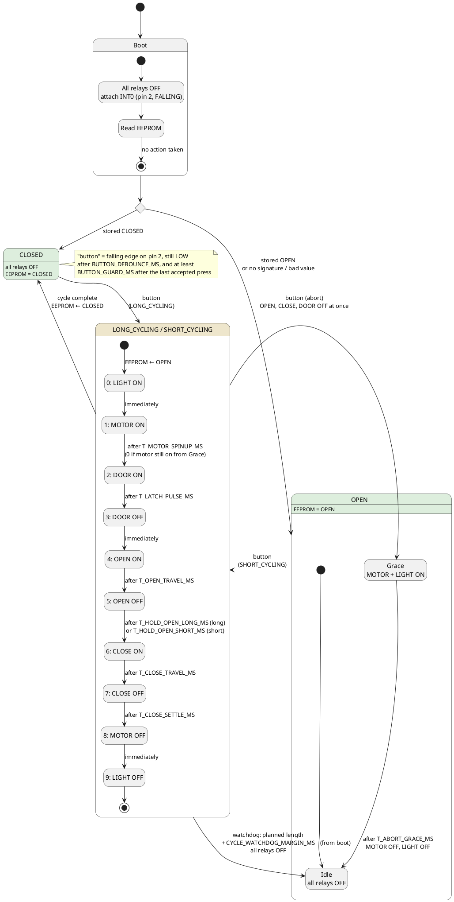
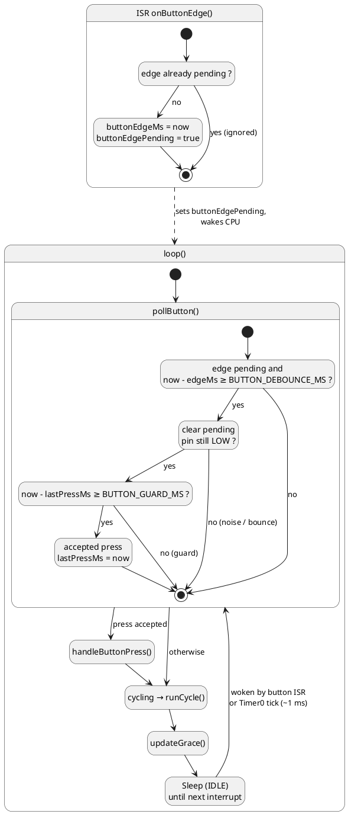

# Portail47v2 — state machine

What `Portail47v2.ino` does as currently written. Relays are active LOW (`RELAY_ON` = `LOW`). Every `T_…` / `BUTTON_…` name is a constant in the **ON-SITE TUNING** block at the top of the sketch.

## Gate states

## Button handling, main loop and interrupt

## Power loss

| Moment of the power cut | EEPROM holds | After power returns |
| --- | --- | --- |
| Gate CLOSED (a cycle completed) | `CLOSED` | CLOSED, nothing moves. Next press: long cycle |
| During any cycle, long or short | `OPEN` (written when the cycle started) | OPEN, nothing moves. Next press: short cycle |
| In OPEN, during or after the grace period | `OPEN` | OPEN, nothing moves. Next press: short cycle |
| First boot / EEPROM from the old sketch | no valid signature | OPEN, nothing moves. Next press: short cycle |
